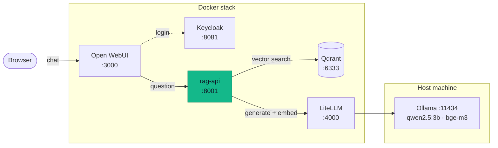

# Local and sovereign RAG document assistant

[](https://github.com/SufGitHB/Local-and-sovereign-RAG-document-assistant/actions/workflows/ci.yml)
[](LICENSE)


Ask questions about your own documents in natural language and get answers
**with their sources** (file and page) — while **every model runs locally**:
no document, question or answer ever leaves the machine.

Final-year engineering project (PFE) — ENSA Fès, ISDIA — by
**Soufiane EL AZZOUZI** and **Achraf BOUCHIKHI**.

## What it does

- **Retrieval-Augmented Generation (RAG):** documents are split into chunks,
  embedded with `bge-m3` and stored in Qdrant; each question retrieves the
  closest chunks, and a local LLM (`qwen2.5:3b`) answers **only** from them,
  citing `[1]`, `[2]`…
- **Refuses what it does not know:** a similarity threshold sends off-topic
  questions to a fixed refusal, without calling the LLM.
- **Verified sovereignty:** at startup the API asks the gateway where each model
  really runs and refuses to start if one is not local; a test blocks all
  network access to prove nothing goes out.
- **Plugs into a chat portal:** the assistant appears as a model (`pfe-rag`) in
  Open WebUI, with single sign-on through Keycloak.
- **Measured, not guessed:** scripts calibrate the threshold and check that
  retrieval finds the expected page.

## Architecture


| Folder | Content |
|---|---|
| [`ai-stack/`](ai-stack/README.md) | The portal: Open WebUI, LiteLLM (single model gateway), Keycloak (SSO), PostgreSQL |
| [`pfe-rag/`](pfe-rag/README.md) | The RAG layer: FastAPI API, Qdrant, indexing, routing, evaluation |

## Requirements

- Docker with the Compose plugin
- [Ollama](https://ollama.com) installed on the host and reachable from
  containers (`OLLAMA_HOST=0.0.0.0:11434`), with the two models:
  ```bash
  ollama pull qwen2.5:3b
  ollama pull bge-m3
  ```
- About 8 GB of free RAM. Runs on CPU; a GPU makes answers much faster.

## Quick start

```bash
# 1. Portal (creates the shared "ai-net" network)
cd ai-stack
cp .env.example .env && chmod 600 .env     # fill in random values: openssl rand -hex 24
docker compose up -d

# 2. RAG layer
cd ../pfe-rag
cp .env.example .env && chmod 600 .env     # same LITELLM_MASTER_KEY as ai-stack
mkdir -p docs && cp /path/to/your/*.pdf docs/
docker compose up -d --build
docker exec rag-api python -m rag.ingest --docs docs --reset
```

Then open http://localhost:3000, log in with **Keycloak**, and choose the
`pfe-rag` model. The first Open WebUI admin has to make the models public
(Admin → Settings → Models) and approve new SSO accounts (Admin → Users).

## Results on the demo corpus

Measured on a 173-page Deep Learning course (159 chunks, not included in the
repository) with 20 reference questions and 10 off-topic ones:

| Measure | Result |
|---|---|
| Correct routing (answer vs. refuse) | 100 % |
| Expected page among the retrieved chunks (hit@5 / hit@1) | 100 % / 95 % |
| External network calls | 0 |
| Answer time on a laptop CPU (i7-8565U) | about one minute; refusals < 0.5 s |

## CI/CD

GitHub Actions (`.github/workflows/ci.yml`) runs on every push: configuration
checks (including "every model exposed by LiteLLM is a local Ollama model"),
the data-sovereignty test, and — on the default branch — the build of the
`rag-api` image, pushed to GitHub Container Registry. Deployment stays manual.

## License

[MIT](LICENSE)
